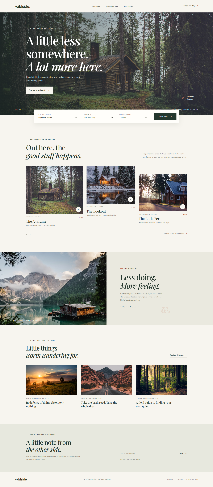

# Wildside

A responsive landing page for Wildside, a collection of thoughtful, design-led cabin stays. Built with plain HTML, CSS, and JavaScript—no build step or framework required.

## Preview

## Run locally

Open `index.html` in a browser, or serve this folder with any static file server. Google Fonts and the cabin photography are loaded from external URLs, so an internet connection is needed for those assets.

## Files

- `index.html` — page structure and content
- `styles.css` — responsive layout, typography, and visual styling
- `script.js` — mobile navigation and form interactions
- `screenshot.png` — full-page desktop preview

## Interactions

- The mobile menu opens and closes and collapses after a navigation link is selected.
- The stay search summarizes the selected destination, date, and guest count.
- The newsletter form validates an email address and displays an on-page confirmation.
